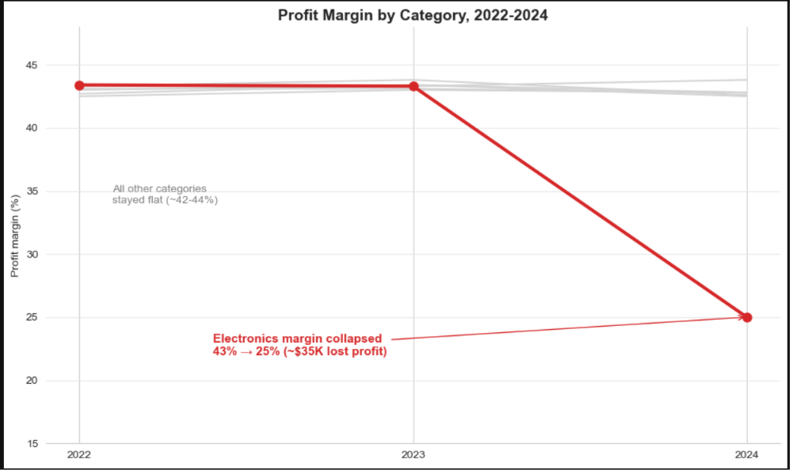
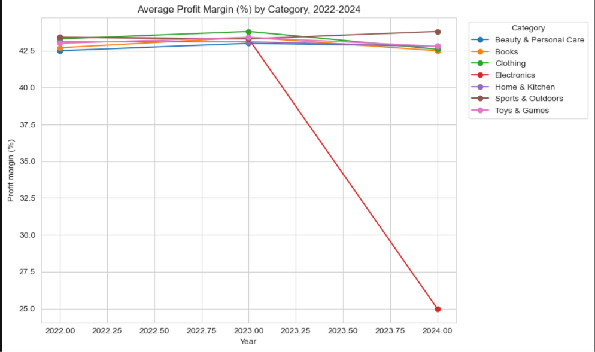
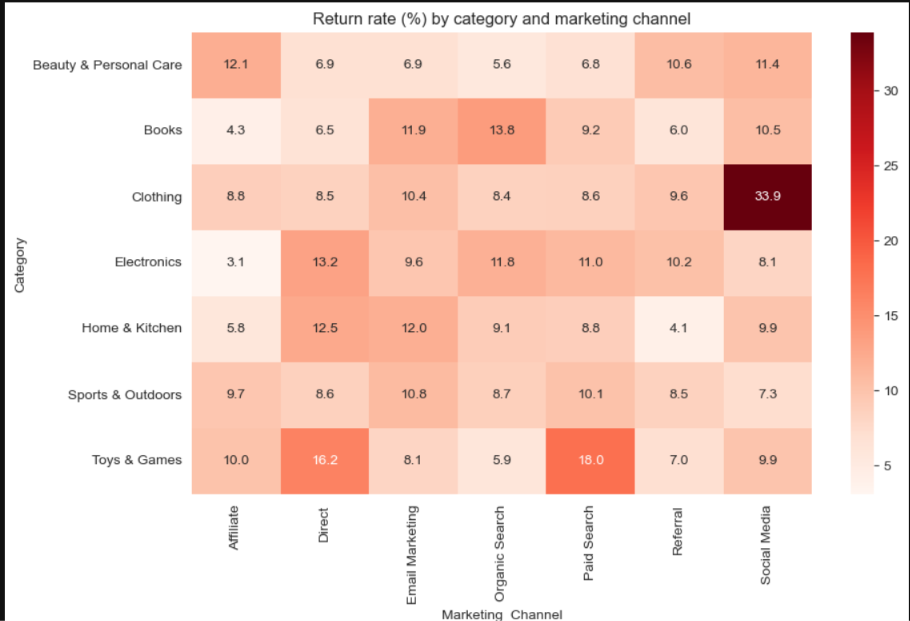
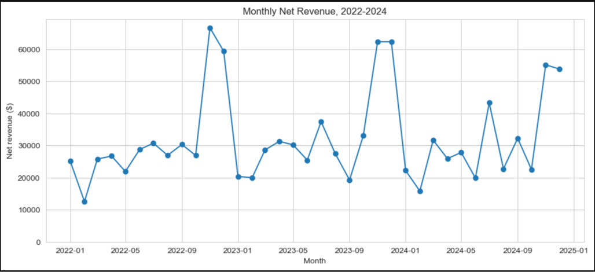
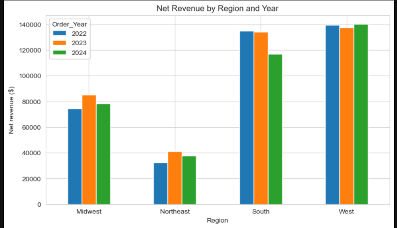
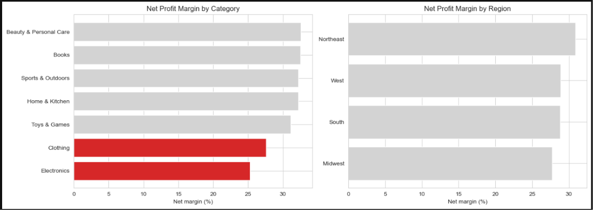
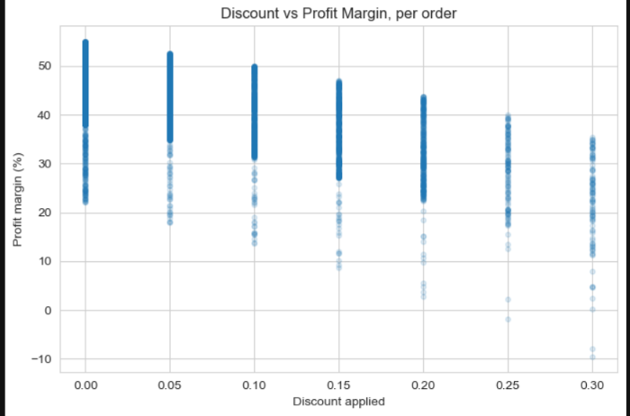
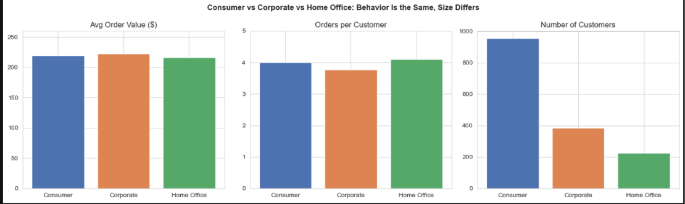
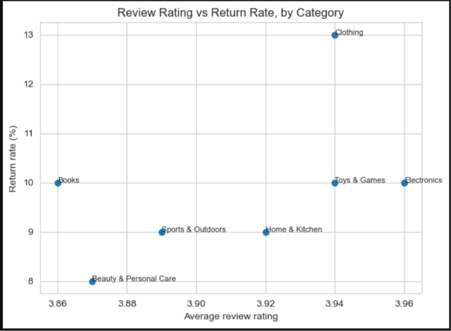

# 📊 TrendMart Sales & Customer Analytics (2022–2024)

## 📌 Project Overview

TrendMart is a mid-sized US-based online retail business operating across 7 product categories. The management team wanted to understand where the business was losing money, which factors were affecting profitability, and where future growth opportunities existed.

As a Data Analyst, I analyzed three years of retail order data (2022–2024), containing approximately **6,200 orders**, to uncover business trends, evaluate customer purchasing behavior, identify profitability issues, and assess marketing-channel performance.

The project involved cleaning inconsistent raw data, performing exploratory data analysis (EDA), engineering business metrics, and translating analytical findings into actionable business recommendations.

**The primary business objective was to answer:**

> Where is TrendMart losing money, and where should the business invest to improve profitability and drive sustainable growth?

---

## 🎯 Business Objectives

The analysis focused on answering eight key business questions:

1. **Category & Regional Profitability:** Which product categories and regions generate the highest revenue and profit? Are any categories losing money after accounting for returns and cancellations?

2. **Profit Margin Analysis:** How have profit margins changed between 2022 and 2024? Are specific product categories experiencing margin deterioration?

3. **Marketing Channel Performance:** Which marketing channels generate disproportionately high return and cancellation rates?

4. **Category & Channel Return Analysis:** Is there a specific product category and marketing-channel combination responsible for unusually high returns?

5. **Customer Segmentation:** How do Average Order Value (AOV), order frequency, and revenue differ across Consumer, Corporate, and Home Office customers?

6. **Regional Growth Analysis:** Are all four business regions growing at the same rate? Which regions are experiencing revenue declines?

7. **Discount & Profitability Analysis:** Are higher discounts increasing customer spending, or are they simply reducing profit margins?

8. **Customer Satisfaction Analysis:** Does customer review rating have any relationship with product returns?

---

## 🛠️ Tools & Technologies

| Tool | Purpose |
|---|---|
| Python | Data analysis and business logic |
| Pandas | Data cleaning, manipulation, aggregation and analysis |
| NumPy | Numerical operations and missing-value handling |
| Matplotlib | Data visualization |
| Seaborn | Statistical visualization and heatmaps |
| Jupyter Notebook | Analysis environment |

**Core analytical techniques:**
- Data Cleaning & Preprocessing
- Exploratory Data Analysis (EDA)
- Feature Engineering
- GroupBy & Aggregation
- Pivot Tables
- Time-Series Analysis
- Customer Segmentation
- Return Rate & Cancellation Analysis
- Profitability Analysis
- Business Insights & Recommendations

---

## 🔄 Project Workflow

### 1. Data Understanding & Initial Exploration

Started by examining the raw retail dataset to understand its structure, data types, missing values, duplicate records, and numerical distributions.

Initial dataset:
- 6,417 records
- 25 columns
- Multiple missing-value representations
- Inconsistent categorical values
- Mixed date formats
- Invalid numerical values and outliers

### 2. Data Cleaning & Preprocessing

Performed systematic data cleaning to improve data quality and ensure reliable analysis.

**Key cleaning operations:**

- Removed duplicate records.
- Converted mixed date formats into consistent datetime values.
- Identified invalid shipping dates and replaced placeholder dates with missing values.
- Standardized Gender values (Male, Female).
- Standardized Category casing and removed unnecessary spaces.
- Standardized Country names and State abbreviations.
- Identified invalid customer ages (below 18 and above 100) and replaced them with missing values.
- Corrected negative Unit_Price values using absolute values.
- Identified zero and unusually high Quantity values and treated them as missing.
- Converted discount percentages greater than 1 into decimal format.
- Replaced invalid review ratings outside the 1–5 range with missing values.
- Identified missing discount values and preserved a separate missing-value indicator.
- Standardized unknown marketing-channel values as missing.

**Final dataset:**
- 6,200 records
- 41 columns
- Cleaned and standardized data ready for analysis.

### 3. Feature Engineering

Created additional analytical columns to calculate business performance metrics.

| Feature | Calculation / Purpose |
|---|---|
| Revenue | Unit Price × Quantity × (1 − Discount %) |
| Total Cost | Cost Price × Quantity |
| Profit | Revenue − Total Cost |
| Profit Margin (%) | (Profit / Revenue) × 100 |
| Net Revenue | Excludes Returned and Cancelled orders |
| Net Profit | Adjusts for the cost of returned and cancelled orders |
| Region | Derived from State |
| Order Year | Extracted from Order Date |
| Order Month | Extracted from Order Date |
| Order Quarter | Extracted from Order Date |
| Order Year-Month | Used for monthly trend analysis |
| Delivery Days | Ship Date − Order Date |

Also created additional indicators to analyze returned and cancelled orders.

### 4. Exploratory Data Analysis (EDA)

Performed business-focused analysis across multiple dimensions:

- Monthly and yearly revenue trends.
- Revenue and profitability by product category.
- Regional revenue and profitability comparisons.
- Marketing-channel return and cancellation rates.
- Category versus marketing-channel return-rate heatmap.
- Annual profit-margin comparison by category.
- Customer segment purchasing behavior.
- Discount percentage versus profitability.
- Customer review ratings versus product return rates.

---

## 📈 Key Business Findings & Insights

### 1. Electronics Profit Margin Decline

**Problem:** Electronics experienced a significant decline in profitability during 2024.

| Year | Profit Margin |
|---|---:|
| 2022 | 43.4% |
| 2023 | 43.3% |
| 2024 | 25.0% |

**Key findings:**
- Six out of seven product categories maintained relatively stable profit margins of approximately 42–44%.
- Electronics profit margin declined from 43.3% in 2023 to 25.0% in 2024.
- Cost of goods as a percentage of selling price increased from approximately 53.8% to 70.2%.
- Selling prices did not adjust sufficiently to compensate for the increase in supplier costs.

**Estimated Financial Impact:**

Approximately **$34,820 in potential lost profit** during 2024, based on the difference between the 2023 and 2024 Electronics margins applied to 2024 revenue.

**Business Recommendation:**
- Review supplier pricing and procurement agreements.
- Reassess Electronics product pricing.
- Monitor category-level cost ratios and profit margins regularly.
- Introduce alerts for significant margin deterioration.

### 2. Clothing Returns from Social Media Marketing

**Problem:** Clothing orders acquired through Social Media showed an unusually high return rate.

| Metric | Return Rate |
|---|---:|
| Overall Business | 10.1% |
| Social Media Channel | 13.5% |
| Clothing × Social Media | 33.9% |

**Key findings:**
- Clothing orders from Social Media had a 33.9% return rate.
- This was more than three times the overall business return rate.
- The combination was supported by 189 orders.
- Approximately 64 returns out of 628 total returns came from this category-channel combination.
- Clothing maintained a relatively high average review rating of 3.94.

**Business Recommendation:**
- Review Social Media advertising creatives and product descriptions.
- Improve clothing size guides and product images.
- Set up channel-specific return-rate monitoring.
- Test alternative advertising creatives and audience targeting.

### 3. Overall Revenue & Seasonality Analysis

**Problem:** Revenue did not demonstrate consistent year-over-year growth.

| Year | Net Revenue | YoY Growth |
|---|---:|---:|
| 2022 | $381,567 | — |
| 2023 | $397,630 | +4.2% |
| 2024 | $372,933 | -6.2% |

**Key findings:**
- Revenue remained relatively flat throughout the three-year period.
- November and December consistently generated approximately twice the revenue of a normal month.
- Around 29–33% of annual revenue came from November and December.
- January and February were consistently weaker months.

**Business Recommendation:**
- Plan inventory and marketing campaigns ahead of the holiday season.
- Introduce targeted promotions during January and February.
- Monitor monthly revenue and customer purchasing patterns to identify growth opportunities.

### 4. Regional Revenue Analysis

**Key findings:**
- West and South were the largest revenue-contributing regions, together accounting for approximately 76% of total revenue.
- Northeast contributed the smallest share, approximately 9%.
- West remained relatively stable and increased by 2.1% in 2024.
- South experienced the largest absolute revenue decline in 2024, approximately $17,256 compared with 2023.
- No region demonstrated conclusive evidence of a persistent demand or fulfillment problem.

**Business Recommendation:**
- Monitor revenue concentration in the West and South.
- Investigate the South's revenue decline through customer demand and fulfillment data.
- Evaluate growth opportunities in the Northeast.

### 5. Category & Regional Profitability

**Key findings:**
- All seven product categories remained net-profitable after adjusting for returned and cancelled orders.
- Electronics had the lowest category net margin at 25.3%.
- Clothing followed with a net margin of 27.6%.
- Other categories maintained net margins of approximately 31–33%.
- Regional net margins remained relatively close, ranging from 27.7% to 30.9%.

**Business Recommendation:**
- Prioritize Electronics supplier-cost and pricing improvements.
- Investigate the Clothing return problem.
- Monitor regional revenue concentration without unnecessarily reducing investment in profitable regions.

### 6. Discount vs Profitability Analysis

**Problem:** Higher discounts consistently reduced profitability without evidence of increasing average order value.

| Discount | Average Revenue | Average Profit Margin |
|---|---:|---:|
| 0% | $228.40 | 45.8% |
| 5% | $236.40 | 42.7% |
| 10% | $209.80 | 39.5% |
| 15% | $193.30 | 36.1% |
| 20% | $194.40 | 31.9% |
| 25% | $152.50 | 28.4% |
| 30% | $150.50 | 22.5% |

**Key findings:**
- Profit margins declined consistently as discount percentages increased.
- Average revenue per order declined from $228.40 with no discount to $150.50 with a 30% discount.
- The analysis did not show evidence that deeper discounts generated larger orders.

**Business Recommendation:**
- Reevaluate high-discount promotional campaigns.
- Introduce discount limits based on product-level profitability.
- Evaluate promotions using incremental profit rather than revenue alone.

### 7. Customer Segment Analysis

Compared purchasing behavior across Consumer, Corporate, and Home Office customers.

| Customer Segment | Customers | Average Order Value | Orders per Customer |
|---|---:|---:|---:|
| Consumer | 955 | $219.10 | 4.00 |
| Corporate | 385 | $222.60 | 3.77 |
| Home Office | 227 | $216.20 | 4.10 |

**Key findings:**
- Average order value was nearly identical across all three segments.
- Order frequency also remained relatively consistent.
- Consumer customers represented the largest customer base.
- Customer segments differed more in customer count than purchasing behavior.

**Business Recommendation:**
- Focus on customer acquisition and retention within the larger Consumer segment.
- Use product category, acquisition channel, and purchasing timing to create more meaningful customer-targeting strategies.

### 8. Customer Satisfaction & Return Analysis

**Key findings:**
- Average review ratings across all categories ranged between 3.86 and 3.96.
- Clothing had an average rating of 3.94 despite having one of the highest category-level return rates (13%).
- No meaningful relationship between average category rating and return rate was observed.

**Business Recommendation:**
- Investigate product expectations, sizing, and advertising accuracy rather than assuming product quality is the primary cause.
- Analyze customer feedback and return reasons at the individual product and channel level.

---

## 💡 Overall Business Recommendations

Based on the analysis, the following actions should be prioritized:

| Priority | Business Issue | Recommended Action |
|---|---|---|
| High | Electronics margin decline | Review supplier costs and product pricing |
| High | Clothing Social Media returns | Improve sizing information and advertising accuracy |
| High | Excessive discounting | Introduce profitability-based discount controls |
| Medium | Revenue seasonality | Strengthen January–February promotions |
| Medium | Regional revenue concentration | Monitor regional performance and explore new markets |
| Medium | Marketing optimization | Evaluate channels using return-adjusted profitability |
| Low | Customer segmentation | Introduce more detailed behavioral segmentation |

---

## 📊 Key Performance Indicators (KPIs)

The project evaluated the following business metrics:

- Total Revenue
- Net Revenue
- Total Cost
- Profit
- Net Profit
- Profit Margin (%)
- Net Profit Margin (%)
- Average Order Value (AOV)
- Return Rate (%)
- Cancellation Rate (%)
- Average Review Rating
- Orders per Customer
- Regional Revenue Contribution
- Category-wise Profitability
- Marketing Channel Return Rate

---

## 🧠 Key Learnings

Through this project, I strengthened my ability to:

- Work with messy, real-world-style retail datasets.
- Identify and resolve inconsistent data formats and invalid values.
- Apply Python libraries for data cleaning and analysis.
- Create business-focused features and KPIs.
- Perform multi-dimensional analysis using Pandas.
- Identify profitability issues beyond simple revenue comparisons.
- Analyze customer behavior, returns, and marketing performance.
- Build meaningful visualizations using Matplotlib and Seaborn.
- Translate analytical findings into practical business recommendations.
- Communicate results from a business and stakeholder perspective.

---

## 📁 Dataset Information

The dataset contains retail order-level information for the period 2022–2024.

It includes information about:

- Customer demographics
- Product categories and product details
- Order and shipping dates
- Pricing, discounts, and costs
- Marketing acquisition channels
- Customer segments
- Order statuses
- Customer review ratings
- Geographic information

---

## 👨‍💻 Author

**Mayank Singh|
Aspiring Data Analyst | SQL | Power BI | Excel | Python**

Passionate about transforming raw data into meaningful insights through data cleaning, exploratory data analysis, visualization, and business reporting.

Currently seeking entry-level Data Analyst opportunities where I can apply my analytical and technical skills to solve real-world business problems.

GitHub: https://github.com/MayankSingh2000

LinkedIn: www.linkedin.com/in/mayank-singh-aaa112135

**Data Analytics Portfolio Project**

Developed as an end-to-end retail sales and customer analytics case study using Python.

**Technologies:** Python | Pandas | NumPy | Matplotlib | Seaborn | Jupyter Notebook

---

⭐ If you find this project useful, feel free to explore the notebook and its analytical findings.

**Thank you for visiting!**#   T r e n d M a r t - S a l e s - C u s t o m e r - A n a l y t i c s 
 
 #   T r e n d M a r t - S a l e s - C u s t o m e r - A n a l y t i c s 
 
 #   T r e n d M a r t - S a l e s - C u s t o m e r - A n a l y t i c s
